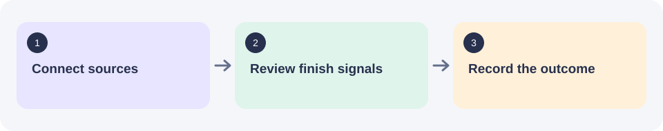

# Video-Growth · YouTube A/B Tests

Track real finish signals for title and thumbnail tests, review outcomes, and keep retests separate.

**Status:** Configured web app plus read-only Chrome extension. A database is required before saving team state. Initials-only sign-in requires no session secret.



## Start here

Choose **Code → Download ZIP**, extract it, then open a Terminal in the extracted project folder. Git users can clone the repository instead.

Node.js 24 and npm for this guide, a PostgreSQL database, and Chrome for the extension.

```sh
npm ci
cp .env.example .env.local
```

Configure database storage below, then start the app with `npm run dev`.

Open **http://127.0.0.1:8770**. Keep the server window open while using the app.

Set `DATABASE_URL` in `.env.local` to enable saved team state. `SESSION_SECRET` is optional for initials-only access. Open Settings and confirm storage readiness, then configure approved Sheets and YouTube access. Install and connect the extension only after the app is ready.

[Step-by-step setup and troubleshooting](docs/GETTING_STARTED.md).

## What needs configuration

| Item | What to know |
| --- | --- |
| DATABASE_URL | Required PostgreSQL connection string. |
| SESSION_SECRET | Optional private random value for signed cookies. Without this and a shared password, initials-only cookies are unsigned. |
| Sheets, YouTube and extension | Configure approved read access and connect the browser after storage is ready. |

## Downloads and help

- [Download and build guide](docs/DOWNLOADS.md) — source files versus packaged apps.
- [Developer reference](docs/REFERENCE.md) — workflow details and relevant limits.
- [Contributing](CONTRIBUTING.md) · [Security](SECURITY.md) · [Usage and licensing](USAGE.md).

## Review outcomes

The focused Review panel offers A/B/C, Not enough viewers / views, Not enough impressions, Not enough data, Performed similarly, No clear winner, Kept current, and Retest later. C appears when C evidence exists. Specific no-winner reasons retain the existing `NO_CLEAR` decision category and are saved in the action note, shown in History, and available when correcting a decision. Old combined no-clear decisions keep their original label. Include reviewer notes in an export to include the specific reason. No existing records or database schema are rewritten.
